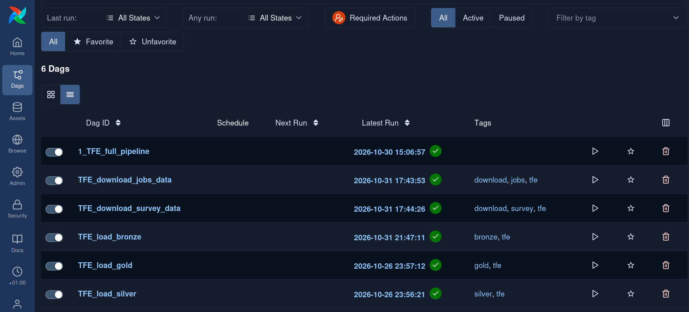
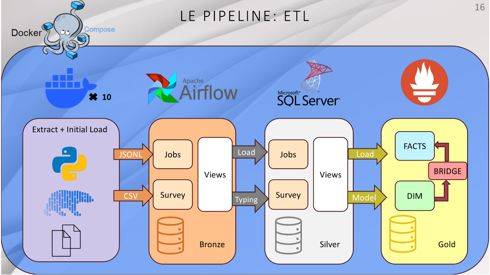

--------

   * [Overview](#overview)
   * [Modelization and Architecture](#modelization-and-architecture)
      * [Modelization](#modelization)
      * [Architecture](#architecture)
   * [Tech Stack](#tech-stack)
   * [Challenges of this project](#challenges-of-this-project)
   * [Repository Organization](#repository-organization)
   * [How to use](#how-to-use)
      * [Dependencies](#dependencies)
      * [Creating the containers](#create-the-containers)
      * [Using the different services](#use-the-different-services)
      * [Removing the containers](#removing-the-containers)
   * [Security Disclaimer](#security-disclaimer)

---------

# Overview

This project was done at the end of my **Data Engineer formation as my TFE** ("Travail de Fin D'education", or "End of formation project"). 

This showcases **some** techonologies we have learned during the cursus.

--------

The goal was to take 2 datasets, clean them, and create a [Data Warehouse](https://en.wikipedia.org/wiki/Data_warehouse) using an [ETL](https://dataengineering.wiki/Concepts/Data+Pipeline#ETL+Pipeline+Example) Pipeline to make them useable by Data Analysts.

My data comes from 2 sources:
- The **jobs postings** data come from Freehire, an aggregator for jobs postings: https://huggingface.co/datasets/istrelov/freehire-jobs/tree/main
- The **survey data comes** from the annual Stack Overflow survey: https://github.com/StackExchange/Survey/tree/main/packages/archive

My goal was to be able to answer the following questions:
- What are the IT skills in demand on the market?
- What are the IT skills IT professionals do have?

**=> An analysis of supply of demand**

# Modelization and Architecture

### Modelization
I decided to use the [Medallion Architecture](https://dataengineering.wiki/Concepts/Data+Architecture/Medallion+Architecture) for this project. While this architecture is usually used in [ELT](https://dataengineering.wiki/Concepts/Data+Pipeline#ELT+Pipeline+Example) projects, it also makes sense to use it for [ETL](https://dataengineering.wiki/Concepts/Data+Pipeline#ETL+Pipeline+Example) projects since it adds a Silver layer that can be used by other Data Professionals like Data Scientists. 

Instead of having raw data and a finished Data Warehouse, we now have a middle layer with minimal transformations that can be used for machine learning and other applications.

**You can find the different schemas in the *modelization* folder of this project.**

### Architecture

**My solution runs entirely on Docker containers.** The containers are setup and organized with Docker Compose.
- Apache Airflow executes Python scripts using the Polars library to cleand and load the data in the Bronze layer of our database.
- Once the data is in the SQL Server database, we use SQL directly to manipulate it. Airflow executes SQL scripts directly on the SQL Server.
- Airflow generates logs that are translated and then transferred to Prometheus.

# Tech Stack

# Challenges of this project

Both datasets had **columns with multiple values.** In a relational SQL database, I needed to find a way to explode these values properly and find the correct model for a Data Warehouse. My solution makes extensive use of [bridge tables](https://en.wikipedia.org/wiki/Associative_entity) to resolve the multiple "many to many" relationships in my data.

The data also needed some cleaning. The Jobs Postings data, for example, is made of 20 .jsonl files, and none of them were valid .jsonl because of a problem with multiple escaped \\" that were not properly managed during the creation of the dataset.

I wanted my solution to be reproducible and easy to build/destroy. This added a layer of complexity to the data engineering dimension of this project.

# Repository Organization

    /config          -> Config files for Airflow
    /dags            -> Dags run by Airflow
      | /utils       -> Python scripts called by the Dags  
      | /sql         -> SQL scripts called by the Dags  
    /images          -> Images for the readme
    /modelization    -> Images of schemas for all layers in our database

    docker-compose.yaml    -> Configuration and organization of our Docker Containers
    prometheus.yaml        -> Configuration of Prometheus
    setup_linux.sh         -> Creates a simple .env file with the current User ID to avoid the Airflow containers to be made with the Root user
    statsd_mapping.yaml    -> Configuration for the translation of logs between Airflow and Prometheus

    ubuntu2604_driver_install_sqlserver.sh -> Script to install the necessary dependencies on Ubuntu 26.04 (WSL or Ubuntu Linux)

# How to use

### Dependencies

- Clone this repository in your WSL (on Windows) or any folder on Linux. The following commands are run int he repository, so make sure to cd to the newly cloned repository.
  

- Make sure you have Docker installed:
    - For Windows and WSL: https://docs.docker.com/desktop/features/wsl/
    - For Linux: https://docs.docker.com/engine/install/ubuntu/
 
      
- Make sure to run 'ubuntu2604_driver_install_sqlserver.sh' on your WSL Ubuntu or on your Ubuntu: this will check if you have the correct dependencies.

      chmod +x ubuntu2604_driver_install_sqlserver.sh
      ./ubuntu2604_driver_install_sqlserver.sh

- Run the setup script in your WSL: this will add your current user's UID to a .env file and ensure the folders are created with the right permissions.

      chmod +x setup_linux.sh
      ./setup_linux.sh

  ### Create the containers

- You can now simply run Docker Compose and wait a minute for the containers to be launched. From your WSL/Linus folder run:

      sudo docker compose up --detach

   ### Use the different services

  You can now go to the following localhost URLs in your browser:

  - Airflow manages the DAGS and can launch the pipeline's tasks: http://localhost:8080/
 
        - Username: airflow
        - Password: airflow
    
  - Prometheus logs: http://localhost:9090/

--------

If you wish to connect to the SQL Server with a client such as SSMS or Dbeaver, use the following connection details:

    - user: sa
    - password: Admin12345!
    - host: localhost
    - port: 1433

-------
### Removing the containers

Once you want to destroy all the containers and delete this repository from your computer:

    sudo docker compose down

You can then safely remove this project's directory from your computer. All the containers are destroyed.

# Security disclaimer

This project is a portfolio project.

As such, it uses default credentials for the different services involved. DO NOT deploy this in production or connect this to the internet.
